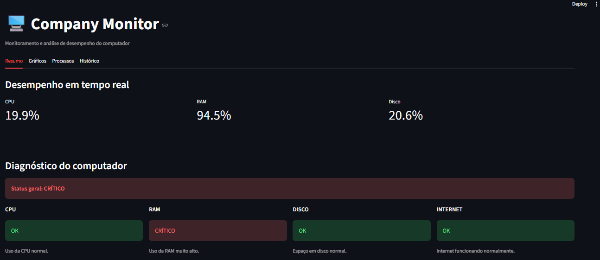

# Company Monitor
 
Aplicação de monitoramento e análise de desempenho de computadores, desenvolvida em Python para Windows.
 
O projeto coleta métricas da máquina, classifica o estado dos recursos, identifica os processos que mais consomem memória, guarda um histórico das medições e apresenta tudo em um dashboard web feito com Streamlit. Também pode ser executado no terminal.



## Tecnologias
 
* Python
* Streamlit (dashboard web)
* Pandas (gráficos e filtros do histórico)
* psutil (coleta de dados do sistema)
* pytest (testes automatizados)
* CSV (histórico das medições)
* Biblioteca padrão: `socket`, `pathlib`, `datetime`, `csv`
## Funcionalidades
 
* Monitoramento de CPU, RAM e disco
* Verificação da conexão com a internet
* Identificação do sistema operacional, nome do computador e uptime
* Classificação dos recursos em `OK`, `ATENÇÃO`, `CRÍTICO` e `INDISPONÍVEL`
* Definição do status geral da máquina
* Identificação dos processos com maior consumo de RAM, em porcentagem e MB
* Histórico de medições salvo em CSV
* Indicadores históricos: médias, valores máximos, tendência de CPU e RAM e contagem de medições por estado
* Dashboard web com diagnósticos coloridos por gravidade
* Dashboard organizado em quatro abas: Resumo, Gráficos, Processos e Histórico
* Atualização automática a cada 5 segundos, que pode ser pausada na barra lateral
* Gráficos históricos de CPU, RAM e disco, com filtro de período e seleção de métricas
* Registro manual de medições pelo dashboard
## Como executar
 
Requisitos: Python 3 instalado.
 
1. Clone o repositório e entre na pasta do projeto:
```bash
git clone https://github.com/Matheus007-pixel/Company-Monitor.git
cd Company-Monitor
```
 
2. Crie e ative um ambiente virtual (opcional, mas recomendado):
```bash
python -m venv .venv
.venv\Scripts\activate
```
 
3. Instale as dependências:
```bash
pip install -r requirements.txt
```
 
4. Execute o dashboard:
```bash
python -m streamlit run dashboard.py
```
 
Ou execute a versão de terminal:
 
```bash
python main.py
```
 
Execute os comandos na raiz do projeto, porque o histórico é salvo em `dados/historico.csv`.
 ## Testes

O módulo de análise tem testes automatizados com pytest, cobrindo os limites de classificação, o status geral, os processos e o histórico.

```bash
python -m pip install pytest
python -m pytest -v
```
## Estrutura
 
```text
Company-Monitor/
├── dados/
│   └── historico.csv   # Histórico das medições (gerado ao usar o programa)
├── docs/
│   ├── dashboard.png   # Captura de tela do dashboard
│   └── evolucao.md     # Evolução técnica e decisões
├── tests/
│   ├── test_analise.py            # Testes das funções de classificação
│   └── test_analisar_historico.py # Testes dos indicadores históricos
├── analise.py          # Classificação e análise dos dados
├── dashboard.py        # Interface web com Streamlit
├── historico.py        # Leitura e gravação do histórico em CSV
├── main.py             # Execução no terminal
├── monitor.py          # Coleta dos dados do sistema
├── pytest.ini          # Configuração do pytest
├── requirements.txt    # Dependências do projeto
└── README.md           # Documentação principal
```
 
## Exemplo de execução no terminal
 
```text
Uso da CPU: 9.3%
Uso da RAM: 91.5%
Uso do Disco: 19.4%
 
--- ANÁLISE DO COMPUTADOR ---
CPU: OK - Uso da CPU normal.
RAM: CRÍTICO - Uso da RAM muito alto.
Disco: OK - Espaço em disco normal.
Internet: OK - Internet funcionando normalmente.
 
STATUS GERAL: CRÍTICO
Computador: Menezes
Uptime: 134 horas, 37 minutos
Sistema Operacional: Windows
 
--- PROCESSOS COM MAIOR CONSUMO DE RAM ---
pycharm64.exe - 16.26% - 1289.03 MB
chrome.exe - 4.87% - 386.42 MB
Spotify.exe - 3.56% - 282.45 MB
```
 
## Roadmap
 
* [x] Monitoramento básico do sistema
* [x] Análise de CPU, RAM, disco e internet
* [x] Status geral da máquina
* [x] Monitoramento de processos
* [x] Consumo de RAM em % e MB
* [x] Histórico de métricas
* [x] Dashboard web
* [x] Indicadores históricos e tendências
* [x] Gráficos históricos de CPU e RAM
* [x] Testes automatizados com pytest
* [ ] Diagnóstico avançado dos processos
* [ ] Banco de dados
* [ ] API com FastAPI
* [ ] Docker
* [ ] Monitoramento de múltiplas máquinas
* [ ] Deploy em cloud
## Documentação
 
A evolução técnica e as decisões tomadas durante o desenvolvimento estão documentadas em [`docs/evolucao.md`](docs/evolucao.md).